# CIRA TBR Tracker

> Automated archive and analytics for CIRA **To-Be-Released (TBR)** `.CA` domain
> drop sessions. Updated every **Wednesday ≈ 19:30 UTC** via GitHub Actions.

**Last updated:** 2026-10-21 &nbsp;|&nbsp; **Total sessions tracked:** 27

---

## What is TBR?

CIRA releases expired `.CA` domains every **Wednesday at 19:00 UTC** via a
first-come, first-served process. Whichever registrar submits a registration
request first wins the domain (one connection, one request per 5 s per registrar).

Capture latency is measured from the official session open at **19:00:00.000 UTC**.

---

## Last Session

- **Date:** 2026-10-21
- **Domains released:** 333
- **Domains registered:** 333
- **Registration rate:** 100.0%
- **Unique registrars:** 10
- **Session duration:** 1,214,911 ms
- **Market concentration (HHI):** 3,152.6

**Capture latency across all registrars:**
- Min: 17 ms | Median: 13321 ms | Mean: 27755.3 ms | P95: 57353 ms | Max: 1214928 ms

**Per-registrar latency breakdown:**

| Registrar | Domains | Min (ms) | Median (ms) | Mean (ms) | P95 (ms) | Max (ms) | StdDev (ms) |
|-----------|--------:|---------:|------------:|----------:|---------:|---------:|------------:|
| WHC Online Solutions Inc. | 146 | 17 | 12421 | 11837.7 | 20128 | 20566 | 6015.3 |
| BareMetal.com inc | 111 | 47 | 16730 | 16753.6 | 30937 | 31553 | 9199.6 |
| MyID.ca INC. | 28 | 455 | 10168 | 135988.2 | 614963 | 1214928 | 299614.4 |
| Register.ca Inc. | 17 | 39 | 4949 | 4215.8 | 15299 | 15299 | 5060.4 |
| 8648255 CANADA LTD. O/A Dynadot LLC | 11 | 1196 | 57353 | 75897.8 | 182824 | 182824 | 72173.9 |
| Webnames.ca Inc. | 10 | 16062 | 93950 | 87399.8 | 156677 | 156677 | 52811.0 |
| Grape Inc. | 5 | 74 | 5079 | 5274.4 | 10835 | 10835 | 5197.5 |
| FastWebServer Internet Services Inc. | 2 | 4991 | 7545 | 7545.5 | 10100 | 10100 | 3612.6 |
| CanSpace Solutions Inc. | 2 | 7490 | 11312 | 11312.5 | 15135 | 15135 | 5405.8 |
| DomainePlus.com (3612040 CANADA inc.) | 1 | 2278 | 2278 | 2278 | 2278 | 2278 | 0 |

**Timing distribution (captures by second offset from 19:00:00 UTC):**

| Offset (s) | Domains Captured |
|-----------:|-----------------:|
| +0 | 26 |
| +1 | 12 |
| +2 | 1 |
| +4 | 13 |
| +5 | 19 |
| +6 | 27 |
| +7 | 13 |
| +8 | 3 |
| +9 | 1 |
| +10 | 18 |
| +11 | 25 |
| +12 | 6 |
| +13 | 9 |
| +14 | 6 |
| +15 | 19 |
| +16 | 26 |
| +17 | 8 |
| +18 | 14 |
| +19 | 6 |
| +20 | 15 |
| +21 | 11 |
| +22 | 3 |
| +23 | 2 |
| +25 | 5 |
| +26 | 11 |
| +27 | 3 |
| +28 | 2 |
| +30 | 5 |
| +31 | 5 |
| +36 | 1 |
| +56 | 1 |
| +57 | 1 |
| +63 | 1 |
| +81 | 1 |
| +106 | 1 |
| +119 | 1 |
| +121 | 1 |
| +126 | 1 |
| +151 | 1 |
| +156 | 1 |
| +166 | 1 |
| +177 | 1 |
| +182 | 1 |
| +599 | 2 |
| +604 | 1 |
| +614 | 1 |
| +1,214 | 1 |

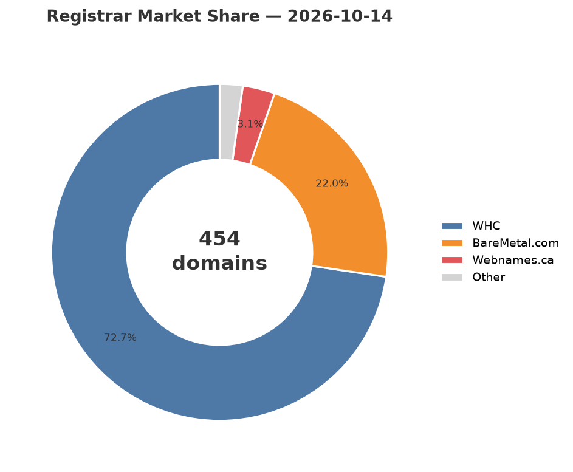

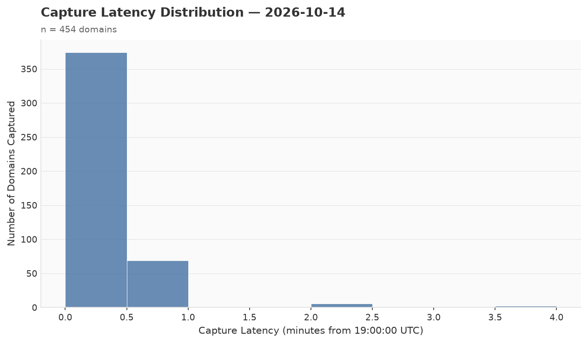

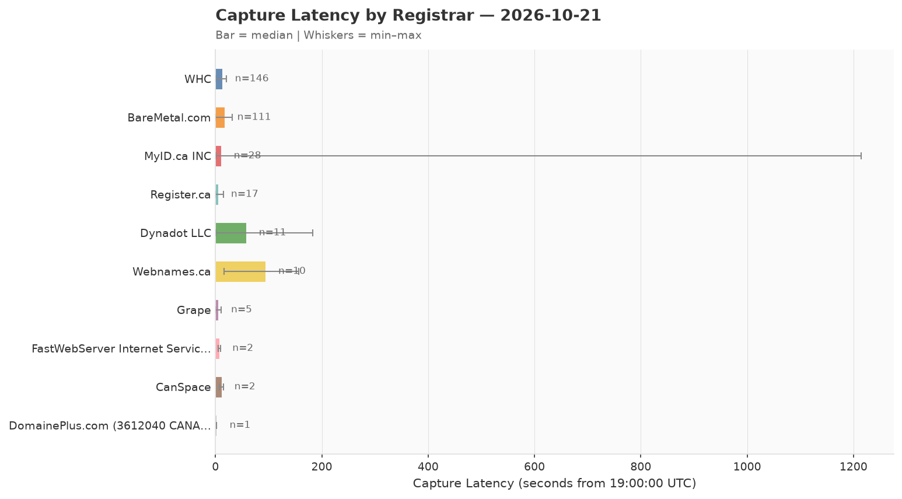

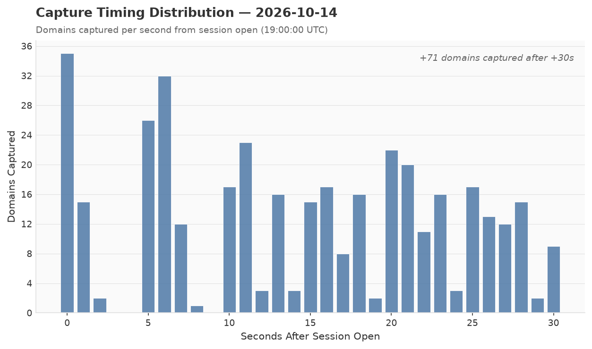

---

## Rolling Windows

### Last 4 Sessions

- **Sessions covered:** 4  (2026-09-30 → 2026-10-21)
- **Total domains registered:** 1,442
- **Avg domains/session:** 360.5
- **Unique registrars (ever active):** 12
- **Avg registrars/session:** 8.2
- **Market concentration HHI:** 4,207.9

| Registrar | Domains | Share | Sessions Active | Mean Latency (ms) |
|-----------|--------:|------:|----------------:|------------------:|
| WHC Online Solutions Inc. | 851 | 59.02% | 4 | 14258.9 |
| BareMetal.com inc | 373 | 25.87% | 4 | 16280.2 |
| Webnames.ca Inc. | 77 | 5.34% | 4 | 128200.2 |
| MyID.ca INC. | 59 | 4.09% | 3 | 48197.8 |
| Register.ca Inc. | 39 | 2.7% | 4 | 3807.7 |
| 8648255 CANADA LTD. O/A Dynadot LLC | 17 | 1.18% | 3 | 79773.7 |
| Grape Inc. | 16 | 1.11% | 4 | 3677.5 |
| FastWebServer Internet Services Inc. | 3 | 0.21% | 2 | 3773.8 |
| Namespro Solutions Inc. | 2 | 0.14% | 1 | 15298.5 |
| PlanetHoster | 2 | 0.14% | 2 | 447 |
| CanSpace Solutions Inc. | 2 | 0.14% | 1 | 11312.5 |
| DomainePlus.com (3612040 CANADA inc.) | 1 | 0.07% | 1 | 2278 |

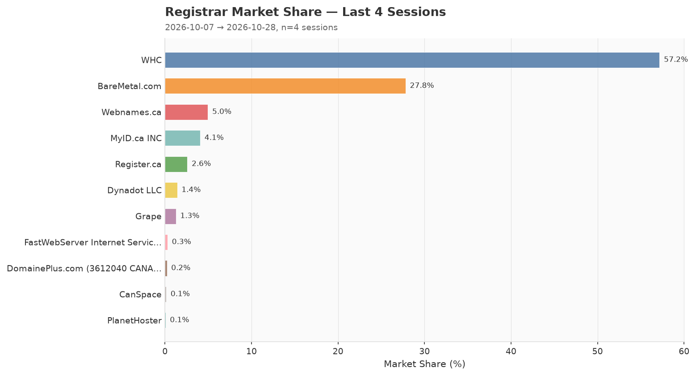

---

### Last ~6 Months (26 Weeks)

- **Sessions covered:** 25  (2026-04-29 → 2026-10-21)
- **Total domains registered:** 6,690
- **Avg domains/session:** 267.6
- **Unique registrars (ever active):** 13
- **Avg registrars/session:** 8.8
- **Market concentration HHI:** 4,283.5

| Registrar | Domains | Share | Sessions Active | Mean Latency (ms) |
|-----------|--------:|------:|----------------:|------------------:|
| WHC Online Solutions Inc. | 4,038 | 60.36% | 25 | 11427.5 |
| BareMetal.com inc | 1,623 | 24.26% | 25 | 14890.2 |
| Webnames.ca Inc. | 310 | 4.63% | 25 | 100659.4 |
| MyID.ca INC. | 297 | 4.44% | 23 | 11930.1 |
| Register.ca Inc. | 179 | 2.68% | 22 | 2856.3 |
| 8648255 CANADA LTD. O/A Dynadot LLC | 99 | 1.48% | 21 | 47315.1 |
| Grape Inc. | 56 | 0.84% | 19 | 2494.2 |
| DomainePlus.com (3612040 CANADA inc.) | 24 | 0.36% | 15 | 3216.4 |
| Namespro Solutions Inc. | 21 | 0.31% | 12 | 25393.1 |
| PlanetHoster | 18 | 0.27% | 13 | 893.6 |
| CanSpace Solutions Inc. | 10 | 0.15% | 8 | 63125.8 |
| easyDNS Technologies Inc. | 9 | 0.13% | 7 | 10801.9 |
| FastWebServer Internet Services Inc. | 6 | 0.09% | 5 | 3739.5 |

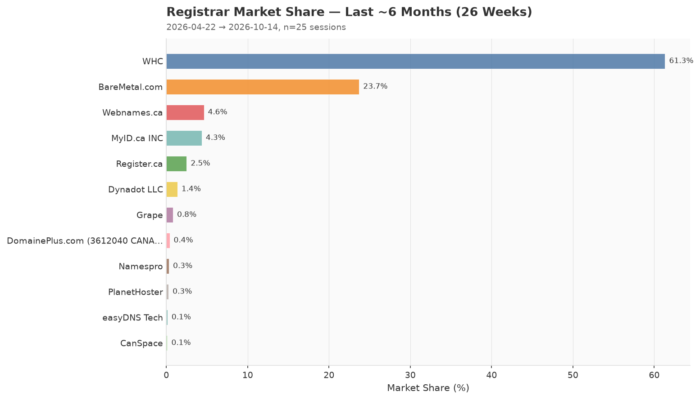

---

### Last 52 Weeks

- **Sessions covered:** 27  (2026-04-15 → 2026-10-21)
- **Total domains registered:** 7,139
- **Avg domains/session:** 264.4
- **Unique registrars (ever active):** 13
- **Avg registrars/session:** 8.9
- **Market concentration HHI:** 4,303.6

| Registrar | Domains | Share | Sessions Active | Mean Latency (ms) |
|-----------|--------:|------:|----------------:|------------------:|
| WHC Online Solutions Inc. | 4,328 | 60.62% | 27 | 11384.0 |
| BareMetal.com inc | 1,716 | 24.04% | 27 | 14654.1 |
| Webnames.ca Inc. | 328 | 4.59% | 27 | 102392.1 |
| MyID.ca INC. | 320 | 4.48% | 25 | 11356.9 |
| Register.ca Inc. | 182 | 2.55% | 24 | 3036.7 |
| 8648255 CANADA LTD. O/A Dynadot LLC | 104 | 1.46% | 23 | 44862.1 |
| Grape Inc. | 62 | 0.87% | 21 | 2503.1 |
| DomainePlus.com (3612040 CANADA inc.) | 29 | 0.41% | 17 | 3438.8 |
| Namespro Solutions Inc. | 23 | 0.32% | 13 | 24380.5 |
| PlanetHoster | 20 | 0.28% | 14 | 1166.9 |
| easyDNS Technologies Inc. | 11 | 0.15% | 8 | 10928.4 |
| CanSpace Solutions Inc. | 10 | 0.14% | 8 | 63125.8 |
| FastWebServer Internet Services Inc. | 6 | 0.08% | 5 | 3739.5 |

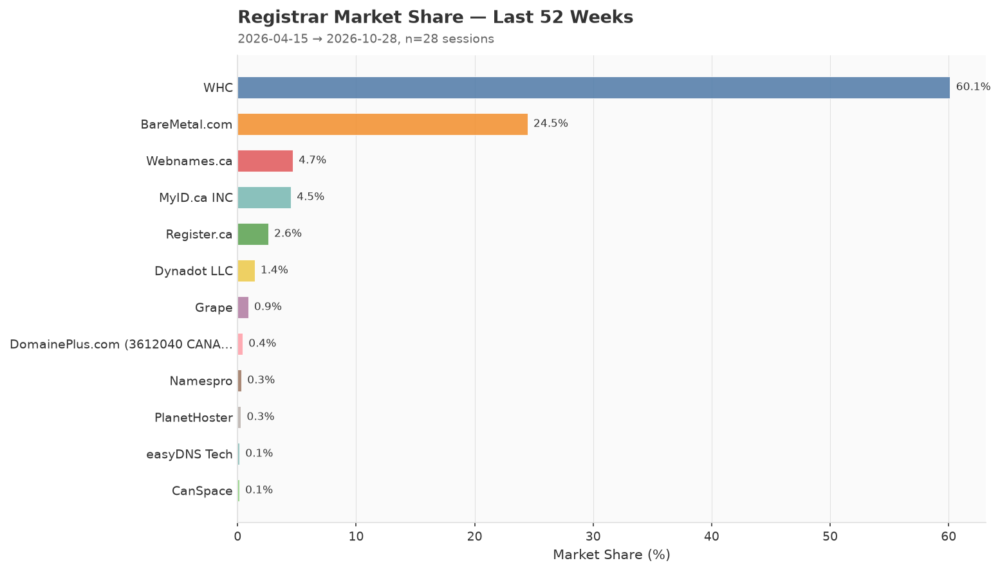

---

## All Time

- **Sessions covered:** 27  (2026-04-15 → 2026-10-21)
- **Total domains registered:** 7,139
- **Avg domains/session:** 264.4
- **Unique registrars (ever active):** 13
- **Avg registrars/session:** 8.9
- **Market concentration HHI:** 4,303.6

| Registrar | Domains | Share | Sessions Active | Mean Latency (ms) |
|-----------|--------:|------:|----------------:|------------------:|
| WHC Online Solutions Inc. | 4,328 | 60.62% | 27 | 11384.0 |
| BareMetal.com inc | 1,716 | 24.04% | 27 | 14654.1 |
| Webnames.ca Inc. | 328 | 4.59% | 27 | 102392.1 |
| MyID.ca INC. | 320 | 4.48% | 25 | 11356.9 |
| Register.ca Inc. | 182 | 2.55% | 24 | 3036.7 |
| 8648255 CANADA LTD. O/A Dynadot LLC | 104 | 1.46% | 23 | 44862.1 |
| Grape Inc. | 62 | 0.87% | 21 | 2503.1 |
| DomainePlus.com (3612040 CANADA inc.) | 29 | 0.41% | 17 | 3438.8 |
| Namespro Solutions Inc. | 23 | 0.32% | 13 | 24380.5 |
| PlanetHoster | 20 | 0.28% | 14 | 1166.9 |
| easyDNS Technologies Inc. | 11 | 0.15% | 8 | 10928.4 |
| CanSpace Solutions Inc. | 10 | 0.14% | 8 | 63125.8 |
| FastWebServer Internet Services Inc. | 6 | 0.08% | 5 | 3739.5 |

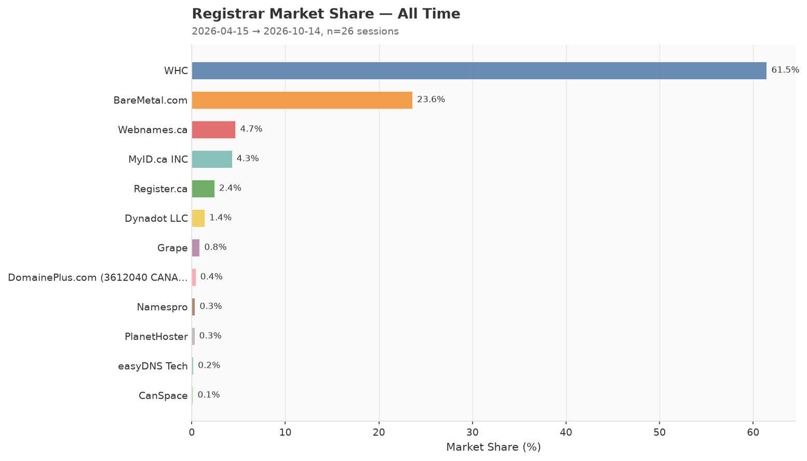

---

## Trends

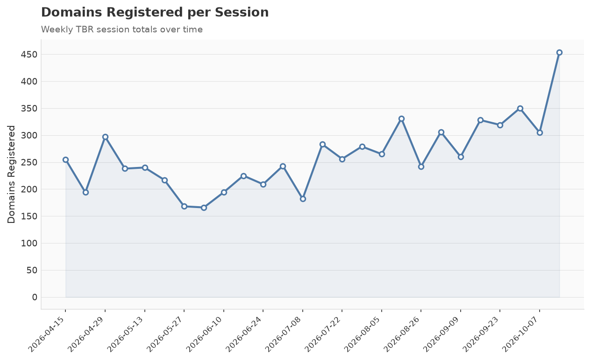

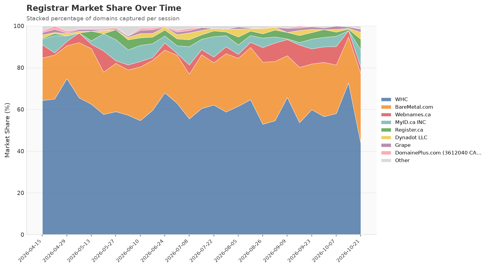

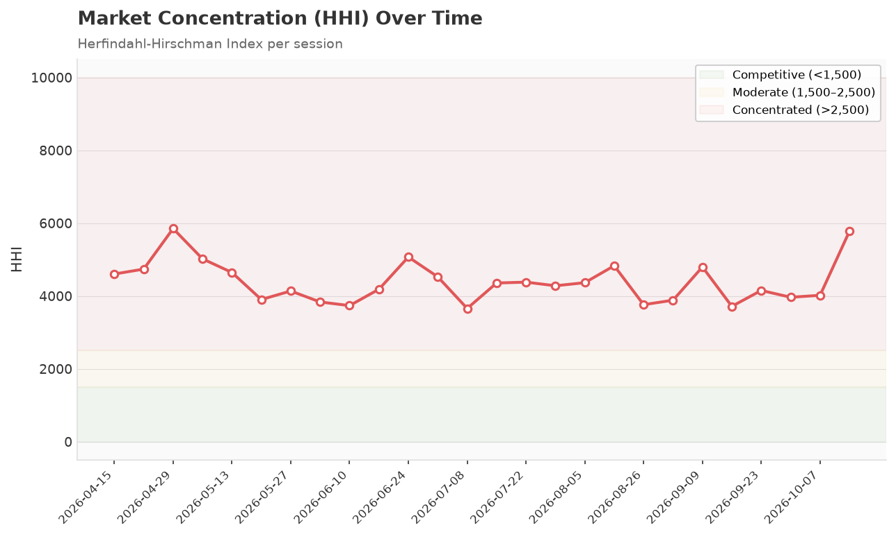

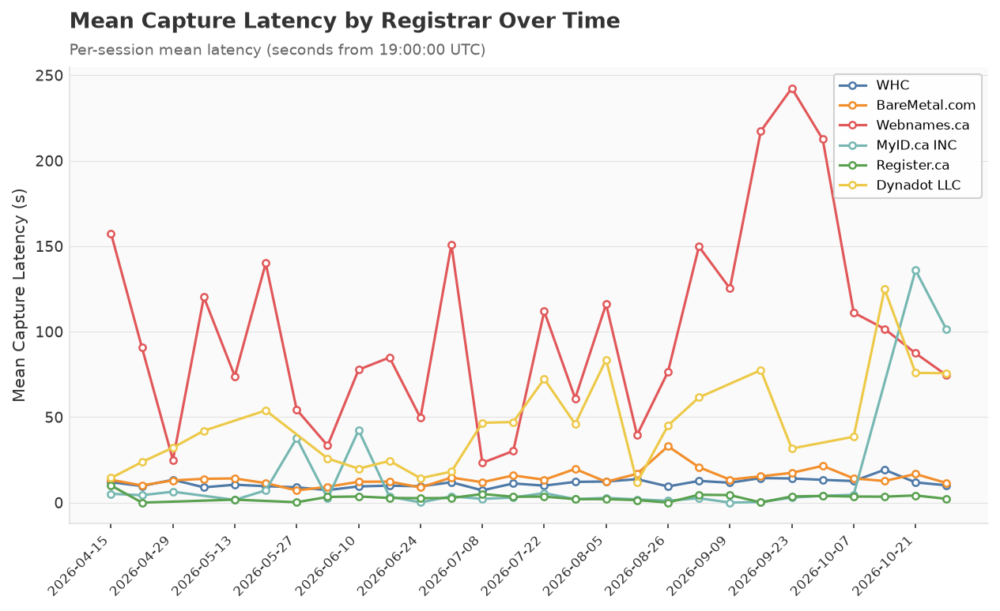

---

## By Year

### 2026

- **Sessions covered:** 27  (2026-04-15 → 2026-10-21)
- **Total domains registered:** 7,139
- **Avg domains/session:** 264.4
- **Unique registrars (ever active):** 13
- **Avg registrars/session:** 8.9
- **Market concentration HHI:** 4,303.6

| Registrar | Domains | Share | Sessions Active | Mean Latency (ms) |
|-----------|--------:|------:|----------------:|------------------:|
| WHC Online Solutions Inc. | 4,328 | 60.62% | 27 | 11384.0 |
| BareMetal.com inc | 1,716 | 24.04% | 27 | 14654.1 |
| Webnames.ca Inc. | 328 | 4.59% | 27 | 102392.1 |
| MyID.ca INC. | 320 | 4.48% | 25 | 11356.9 |
| Register.ca Inc. | 182 | 2.55% | 24 | 3036.7 |
| 8648255 CANADA LTD. O/A Dynadot LLC | 104 | 1.46% | 23 | 44862.1 |
| Grape Inc. | 62 | 0.87% | 21 | 2503.1 |
| DomainePlus.com (3612040 CANADA inc.) | 29 | 0.41% | 17 | 3438.8 |
| Namespro Solutions Inc. | 23 | 0.32% | 13 | 24380.5 |
| PlanetHoster | 20 | 0.28% | 14 | 1166.9 |
| easyDNS Technologies Inc. | 11 | 0.15% | 8 | 10928.4 |
| CanSpace Solutions Inc. | 10 | 0.14% | 8 | 63125.8 |
| FastWebServer Internet Services Inc. | 6 | 0.08% | 5 | 3739.5 |

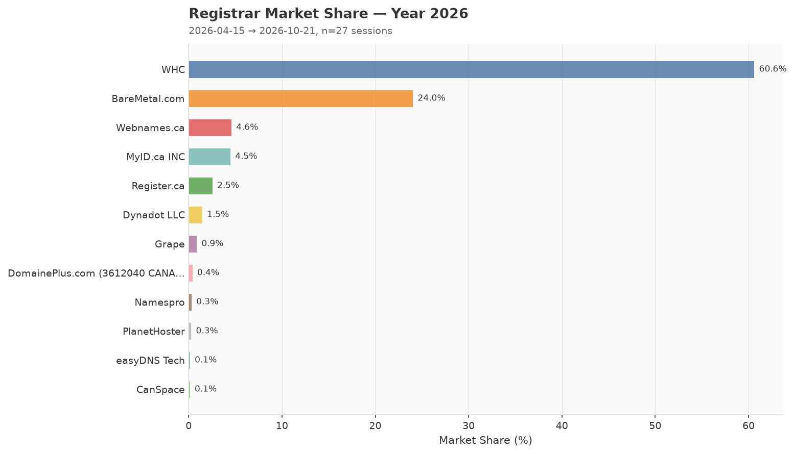

---

## By Month

#### 2026-04

- **Sessions covered:** 3  (2026-04-15 → 2026-04-29)
- **Total domains registered:** 746
- **Avg domains/session:** 248.7
- **Unique registrars (ever active):** 12
- **Avg registrars/session:** 10
- **Market concentration HHI:** 5,094.3

| Registrar | Domains | Share | Sessions Active | Mean Latency (ms) |
|-----------|--------:|------:|----------------:|------------------:|
| WHC Online Solutions Inc. | 512 | 68.63% | 3 | 11691.0 |
| BareMetal.com inc | 140 | 18.77% | 3 | 12138.8 |
| MyID.ca INC. | 31 | 4.16% | 3 | 5312.3 |
| Webnames.ca Inc. | 24 | 3.22% | 3 | 91027.8 |
| 8648255 CANADA LTD. O/A Dynadot LLC | 8 | 1.07% | 3 | 23467.1 |
| DomainePlus.com (3612040 CANADA inc.) | 8 | 1.07% | 3 | 5592 |
| Grape Inc. | 7 | 0.94% | 3 | 1755.4 |
| Namespro Solutions Inc. | 5 | 0.67% | 2 | 21235.8 |
| PlanetHoster | 4 | 0.54% | 2 | 2473.2 |
| easyDNS Technologies Inc. | 3 | 0.4% | 2 | 9532.5 |
| Register.ca Inc. | 3 | 0.4% | 2 | 5020.8 |
| CanSpace Solutions Inc. | 1 | 0.13% | 1 | 472283 |

#### 2026-05

- **Sessions covered:** 4  (2026-05-06 → 2026-05-27)
- **Total domains registered:** 863
- **Avg domains/session:** 215.8
- **Unique registrars (ever active):** 12
- **Avg registrars/session:** 8.2
- **Market concentration HHI:** 4,411.2

| Registrar | Domains | Share | Sessions Active | Mean Latency (ms) |
|-----------|--------:|------:|----------------:|------------------:|
| WHC Online Solutions Inc. | 530 | 61.41% | 4 | 9509.0 |
| BareMetal.com inc | 210 | 24.33% | 4 | 11662.0 |
| Webnames.ca Inc. | 40 | 4.63% | 4 | 97153.4 |
| MyID.ca INC. | 39 | 4.52% | 3 | 15531.4 |
| Register.ca Inc. | 19 | 2.2% | 2 | 999.5 |
| Grape Inc. | 5 | 0.58% | 3 | 49.7 |
| 8648255 CANADA LTD. O/A Dynadot LLC | 5 | 0.58% | 2 | 47995.1 |
| DomainePlus.com (3612040 CANADA inc.) | 5 | 0.58% | 4 | 735.9 |
| Namespro Solutions Inc. | 3 | 0.35% | 2 | 17200.2 |
| PlanetHoster | 3 | 0.35% | 2 | 2718.8 |
| easyDNS Technologies Inc. | 3 | 0.35% | 2 | 12175.8 |
| CanSpace Solutions Inc. | 1 | 0.12% | 1 | 7370 |

#### 2026-06

- **Sessions covered:** 4  (2026-06-03 → 2026-06-24)
- **Total domains registered:** 794
- **Avg domains/session:** 198.5
- **Unique registrars (ever active):** 11
- **Avg registrars/session:** 8.8
- **Market concentration HHI:** 4,202.1

| Registrar | Domains | Share | Sessions Active | Mean Latency (ms) |
|-----------|--------:|------:|----------------:|------------------:|
| WHC Online Solutions Inc. | 477 | 60.08% | 4 | 9082.6 |
| BareMetal.com inc | 183 | 23.05% | 4 | 10680.8 |
| MyID.ca INC. | 49 | 6.17% | 4 | 12134.8 |
| Register.ca Inc. | 28 | 3.53% | 4 | 3083.2 |
| Webnames.ca Inc. | 19 | 2.39% | 4 | 61415.4 |
| 8648255 CANADA LTD. O/A Dynadot LLC | 13 | 1.64% | 4 | 21115.8 |
| Grape Inc. | 8 | 1.01% | 3 | 1671.7 |
| Namespro Solutions Inc. | 6 | 0.76% | 2 | 21410.8 |
| DomainePlus.com (3612040 CANADA inc.) | 5 | 0.63% | 3 | 4468.5 |
| PlanetHoster | 4 | 0.5% | 2 | 571.8 |
| easyDNS Technologies Inc. | 2 | 0.25% | 1 | 30047.5 |

#### 2026-07

- **Sessions covered:** 5  (2026-07-01 → 2026-07-29)
- **Total domains registered:** 1,243
- **Avg domains/session:** 248.6
- **Unique registrars (ever active):** 13
- **Avg registrars/session:** 9.8
- **Market concentration HHI:** 4,255.0

| Registrar | Domains | Share | Sessions Active | Mean Latency (ms) |
|-----------|--------:|------:|----------------:|------------------:|
| WHC Online Solutions Inc. | 748 | 60.18% | 5 | 10484.8 |
| BareMetal.com inc | 298 | 23.97% | 5 | 15128.8 |
| MyID.ca INC. | 79 | 6.36% | 5 | 3309.2 |
| Webnames.ca Inc. | 33 | 2.65% | 5 | 75460.8 |
| Register.ca Inc. | 32 | 2.57% | 5 | 3368.1 |
| 8648255 CANADA LTD. O/A Dynadot LLC | 24 | 1.93% | 5 | 46077.7 |
| Grape Inc. | 9 | 0.72% | 3 | 2242.8 |
| PlanetHoster | 6 | 0.48% | 5 | 699.4 |
| DomainePlus.com (3612040 CANADA inc.) | 4 | 0.32% | 2 | 8745.8 |
| Namespro Solutions Inc. | 4 | 0.32% | 3 | 44709.7 |
| easyDNS Technologies Inc. | 3 | 0.24% | 3 | 4654.3 |
| FastWebServer Internet Services Inc. | 2 | 0.16% | 2 | 3029.5 |
| CanSpace Solutions Inc. | 1 | 0.08% | 1 | 549 |

#### 2026-08

- **Sessions covered:** 3  (2026-08-05 → 2026-08-26)
- **Total domains registered:** 838
- **Avg domains/session:** 279.3
- **Unique registrars (ever active):** 11
- **Avg registrars/session:** 8.7
- **Market concentration HHI:** 4,338.3

| Registrar | Domains | Share | Sessions Active | Mean Latency (ms) |
|-----------|--------:|------:|----------------:|------------------:|
| WHC Online Solutions Inc. | 505 | 60.26% | 3 | 11862.8 |
| BareMetal.com inc | 216 | 25.78% | 3 | 20684.8 |
| MyID.ca INC. | 34 | 4.06% | 3 | 1924.2 |
| Webnames.ca Inc. | 30 | 3.58% | 3 | 77406.9 |
| Register.ca Inc. | 22 | 2.63% | 3 | 1204.8 |
| 8648255 CANADA LTD. O/A Dynadot LLC | 20 | 2.39% | 3 | 46853.3 |
| Grape Inc. | 4 | 0.48% | 2 | 6010.5 |
| CanSpace Solutions Inc. | 3 | 0.36% | 2 | 2473 |
| Namespro Solutions Inc. | 2 | 0.24% | 2 | 23856 |
| DomainePlus.com (3612040 CANADA inc.) | 1 | 0.12% | 1 | 75 |
| PlanetHoster | 1 | 0.12% | 1 | 418 |

#### 2026-09

- **Sessions covered:** 5  (2026-09-02 → 2026-09-30)
- **Total domains registered:** 1,563
- **Avg domains/session:** 312.6
- **Unique registrars (ever active):** 12
- **Avg registrars/session:** 8.2
- **Market concentration HHI:** 4,042.4

| Registrar | Domains | Share | Sessions Active | Mean Latency (ms) |
|-----------|--------:|------:|----------------:|------------------:|
| WHC Online Solutions Inc. | 903 | 57.77% | 5 | 13243.2 |
| BareMetal.com inc | 387 | 24.76% | 5 | 17715.3 |
| Webnames.ca Inc. | 131 | 8.38% | 5 | 189495.8 |
| Register.ca Inc. | 52 | 3.33% | 5 | 3348.2 |
| MyID.ca INC. | 45 | 2.88% | 5 | 1985.1 |
| 8648255 CANADA LTD. O/A Dynadot LLC | 17 | 1.09% | 3 | 56901.7 |
| Grape Inc. | 16 | 1.02% | 4 | 3589.0 |
| DomainePlus.com (3612040 CANADA inc.) | 5 | 0.32% | 3 | 1829.8 |
| Namespro Solutions Inc. | 3 | 0.19% | 2 | 7705.8 |
| CanSpace Solutions Inc. | 2 | 0.13% | 2 | 4273 |
| FastWebServer Internet Services Inc. | 1 | 0.06% | 1 | 5091 |
| PlanetHoster | 1 | 0.06% | 1 | 394 |

#### 2026-10

- **Sessions covered:** 3  (2026-10-07 → 2026-10-21)
- **Total domains registered:** 1,092
- **Avg domains/session:** 364.0
- **Unique registrars (ever active):** 11
- **Avg registrars/session:** 8.3
- **Market concentration HHI:** 4,289.7

| Registrar | Domains | Share | Sessions Active | Mean Latency (ms) |
|-----------|--------:|------:|----------------:|------------------:|
| WHC Online Solutions Inc. | 653 | 59.8% | 3 | 14566.6 |
| BareMetal.com inc | 282 | 25.82% | 3 | 14532.8 |
| Webnames.ca Inc. | 51 | 4.67% | 3 | 100075.2 |
| MyID.ca INC. | 43 | 3.94% | 2 | 70304.6 |
| Register.ca Inc. | 26 | 2.38% | 3 | 3770.0 |
| 8648255 CANADA LTD. O/A Dynadot LLC | 17 | 1.56% | 3 | 79773.7 |
| Grape Inc. | 13 | 1.19% | 3 | 3010.0 |
| FastWebServer Internet Services Inc. | 3 | 0.27% | 2 | 3773.8 |
| CanSpace Solutions Inc. | 2 | 0.18% | 1 | 11312.5 |
| PlanetHoster | 1 | 0.09% | 1 | 500 |
| DomainePlus.com (3612040 CANADA inc.) | 1 | 0.09% | 1 | 2278 |

---

## Data & Files

| Path | Description |
|------|-------------|
| `data/YYYY/MM/DD.json` | Raw API response for each session |
| `tally.json` | Machine-readable aggregate statistics |
| `charts/` | Auto-generated visualizations (PNG) |
| `README.md` | This file — auto-generated each week |

---

## Metrics Glossary

| Metric | Description |
|--------|-------------|
| **Market Share %** | Percentage of session domains captured by a registrar |
| **HHI (Herfindahl-Hirschman Index)** | Market concentration; 10,000 = monopoly, <1,500 = competitive |
| **Capture Latency (ms)** | Milliseconds from session open (19:00:00.000 UTC) to domain registration timestamp |
| **Session Duration (ms)** | Time elapsed between the first and last domain captured in a session |
| **P95 Latency** | 95th-percentile capture latency — 95% of captures happened at or below this value |
| **StdDev Latency** | Standard deviation of capture latencies; lower = more consistent timing |
| **Session Presence %** | Share of sessions in which a registrar captured at least one domain |
| **Mean of Means Latency** | Average of per-session mean latencies across multiple sessions |
| **Timing Distribution** | Histogram of domain captures bucketed by second offset from session open |
| **Registration Rate %** | Fraction of released domains that were actually registered in the session |
